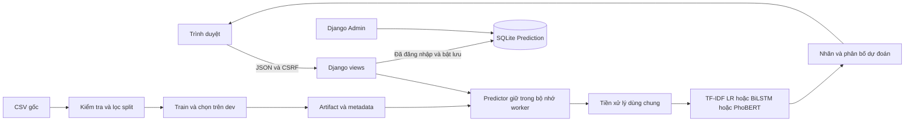

# Kiến trúc và quy trình dữ liệu

## Ranh giới module

- `config` cấu hình hạ tầng web, không huấn luyện model khi khởi động Django.
- `detector.views` kiểm tra request, gọi dịch vụ dự đoán, lưu lịch sử theo cấu hình. Không cho client chọn đường dẫn model hoặc upload artifact.
- `detector.services` nạp model một lần cho mỗi process; thay artifact cần restart process.
- `ml.preprocessing` dùng chung ở prepare, train, inference và đánh giá ngoài miền.
- `ml.data` và `ml.protocol` kiểm tra split, nhãn, trùng và rò rỉ.
- `ml.train_baseline` và `ml.train_deep` chạy offline, không chạy tác vụ huấn luyện nặng trong HTTP request.
- `ml.evaluation` xuất bộ chỉ số và lỗi; `ml.inference` chỉ đọc artifact đã huấn luyện.

## Chính sách dữ liệu

Giữ split gốc làm điểm xuất phát; ưu tiên test trước dev trước train. Trong từng split, cùng khóa khác nhãn bị loại cả nhóm; cùng khóa cùng nhãn giữ bản đầu. Khóa dùng các phép biến đổi được khai báo. Mọi model trong một phép so sánh phải dùng chung bản CSV sau lọc. Audit ghi từng bước và nhãn cuối. Downloader ghi revision/hash nguồn, model metadata ghi hash split để đối chiếu.

Tất cả dữ liệu thật và artifact mặc định bị loại khỏi Git. Không đưa dữ liệu tổng hợp của kiểm thử vào bảng kết quả báo cáo. Không tối ưu siêu tham số dựa vào test.

## Phục vụ model

Baseline dùng joblib, kiểm tra SHA256 và thứ tự lớp trước khi dự đoán. Checksum phát hiện hỏng dữ liệu, không xác thực nguồn; chỉ nạp artifact tin cậy. BiLSTM nạp state dict với `weights_only=True`, không deserialize mô hình Python tùy ý. PhoBERT nạp tokenizer và classifier từ thư mục cục bộ, không tải qua mạng trong request.

Web phục vụ một model được cấu hình qua `TOXIC_MODEL_DIR`, không tải cả ba model cùng lúc. Tensor inference chạy CPU ở web để giữ cấu hình demo đơn giản; train có hỗ trợ GPU. Không có fallback giả khi model thiếu.

## Quyền truy cập

Người ẩn danh dùng dự đoán khi model sẵn sàng, không đọc được lịch sử. Tài khoản đã đăng nhập chỉ đọc 100 bản ghi gần nhất của mình. Django Admin quản lý bản ghi theo quyền tài khoản. Mặc định không ghi bình luận; `STORE_PREDICTIONS=1` chỉ bật lưu cho tài khoản đã đăng nhập.

Chưa có đăng ký người dùng công khai, API token, hàng đợi batch lớn hay dashboard đa tổ chức. Đây là ứng dụng đồ án một nhóm; không tự nhận đã đạt yêu cầu vận hành dịch vụ công cộng.
